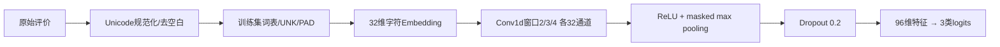
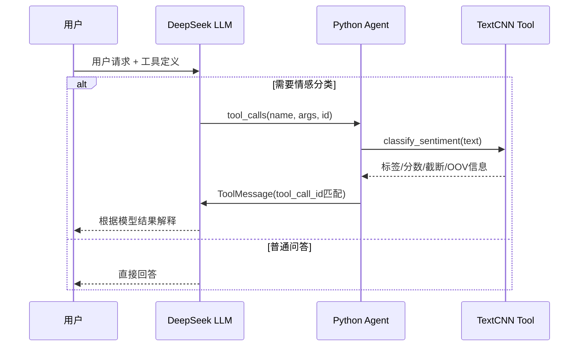

# TextCNN × LLM Agent：把本地 PyTorch 模型变成工具

一个面向 Agent 开发实习岗位的个人 Demo，展示两个核心能力：

1. **PyTorch 模型开发**：从数据读取、字符词表、TextCNN 定义、CPU 训练到验证选模、测试评估和权重加载。
2. **Agent Tool Calling 封装**：把本地模型封装为 LangChain `@tool`，由 DeepSeek 自主决定是否调用，再读取工具返回结果给用户解释。

任务是中文商品/服务评价的三分类：`negative`（负面）、`neutral`（中性）、`positive`（正面）。不需要GPU，不下载预训练语言模型；只有真实 Agent 演示需要大模型API。

## 项目结构

```text
textcnn_agent_demo/
├── model.py             # 预处理、训练词表、编码、TextCNN
├── train.py             # Dataset/DataLoader、训练、验证选模、测试、保存
├── classifier_tool.py   # 权重加载、推理、LangChain工具
├── agent_demo.py        # LLM工具决策与结果回传循环
├── test_demo.py         # 离线工程测试
├── data/sentiment.jsonl # 固定手写数据与划分
├── artifacts/
│   ├── textcnn.pt       # 实际训练产生的轻量权重、词表、标签和配置
│   └── metrics.json     # 验证/测试指标、训练历史、参数量及耗时
├── requirements.txt
├── .env.example
├── .gitignore
├── .gitattributes
└── README.md
```

## 快速运行

推荐 Windows/Linux x86_64、**Python 3.13（64位）**。Windows从PyPI安装固定版本；Linux先按下方命令安装CPU wheel，再安装其余依赖，避免下载CUDA组件。安装需要访问PyPI，Linux CPU wheel还需访问PyTorch官方下载站。macOS/ARM需另行使用适合平台的PyTorch wheel，本项目未验证这些平台。

### Windows PowerShell

```powershell
py -3.13 -m venv .venv
.\.venv\Scripts\python.exe -m pip install -r requirements.txt
# 从零训练，不需要任何API密钥
.\.venv\Scripts\python.exe train.py
# 直接推理本地模型
.\.venv\Scripts\python.exe classifier_tool.py "这个产品很好用，我很满意"
# 离线验证工具调用协议，真正执行已训练的PyTorch模型
.\.venv\Scripts\python.exe agent_demo.py --offline-demo
.\.venv\Scripts\python.exe -m unittest -v
```

### Linux

```bash
python3 -m venv .venv
source .venv/bin/activate
python -m pip install torch==2.14.0 --index-url https://download.pytorch.org/whl/cpu
python -m pip install -r requirements.txt
python train.py
python classifier_tool.py "收到的产品坏了，非常失望"
python agent_demo.py --offline-demo
python -m unittest -v
```

仓库包含实际训练后的权重，可跳过重新训练直接推理；运行 `train.py` 会更新本地权重和指标。默认最多35轮，验证集macro-F1连续8轮未提高会提前停止。

```bash
python train.py --epochs 35 --seed 42
# 可用自定义数据，JSONL每行包含text、label、split
python train.py --data data/sentiment.jsonl --output-dir artifacts
```

## 接入真实 Agent

复制 `.env.example` 为 `.env`，填写 `DEEPSEEK_API_KEY`；不要提交真实密钥。

```dotenv
DEEPSEEK_API_KEY=your_deepseek_api_key
LLM_BASE_URL=https://api.deepseek.com
LLM_MODEL=deepseek-flash
```

```bash
python agent_demo.py
python agent_demo.py --text "请分析这条评价：质量太差了，刚收到就坏了"
python agent_demo.py --text "你好，什么是文本分类？"
```

默认演示先问候，再要求评价分类：问候应直接回答，分类请求由模型选择 `classify_sentiment` 并生成 `text` 参数。没有通过代码关键词判断来冒充自主决策，也没有设置强制工具调用。具体行为仍取决于LLM返回。

**`--offline-demo` 的边界**：使用固定脚本返回工具请求，真实执行TextCNN并回传结果；它只验证工具协议，不是LLM，也不证明自主决策能力。真实自主决策必须使用API模式。每次用户请求独立，本项目不实现跨请求对话记忆。

## 模型原理与训练流程



- 字符级编码，最大长度64，超长截断、短文本补零；训练和推理共用代码。
- `padding_idx=0`；池化时屏蔽完全位于padding区域的窗口。
- 使用Adam（学习率0.003）、batch size 16和CrossEntropyLoss。训练传入原始logits，推理才做softmax。
- 固定随机种子，CPU两线程，启用确定性算法；不同平台/版本仍可能存在数值差异。
- 词表**只从训练集构建**，验证/测试新字符映射为UNK。
- 验证集macro-F1选择最佳权重；选模结束后才评估独立测试集。
- checkpoint保存`state_dict`、配置、词表和标签；推理使用`map_location="cpu"`、`weights_only=True`、`eval()`与`inference_mode()`。

## 数据和指标的诚实说明

数据是本项目手写的**126条教学样本**：训练90条、验证18条、测试18条，各划分三类均衡。文本不完全重复，加载时自动检查规范化后的重复项。数据来源不是公开业务语料，表达模式较简单且存在相似句式。

因此，即使小测试集取得高分，也**不能代表真实场景泛化效果**。没有对反讽、隐含情绪、复杂否定、多方面情感、长文本和领域迁移做充分评估。测试集不用于调整模型或挑选训练轮数。

实际训练结果见 [`artifacts/metrics.json`](artifacts/metrics.json)，包含accuracy、macro-F1、各类precision/recall/F1和混淆矩阵。矩阵行是真实类别、列是预测类别，顺序为negative、neutral、positive。

本次CPU实测（种子42，按验证集选取第5轮权重）：

| 项目 | 结果 |
| --- | --- |
| 参数量 | 22,179 |
| checkpoint大小 | 98,358字节，约96KiB |
| 验证集Macro-F1 | 0.9441 |
| 独立测试Accuracy | 0.7222（13/18） |
| 独立测试Macro-F1 | 0.7050 |
| 负面类别Recall | 0.3333（2/6） |

负面类别召回偏低，说明当前负面识别能力不足；复杂否定和相近情感词还需要专门评估。保留这次独立测试结果，不依据测试集反复选种子或调参；后续应先收集更多训练数据，再用新的独立评估集验证。

工具返回的`score`是softmax最大值，**未经过概率校准**，不应称作“正确率”。同时返回完整概率分布、`truncated`和`unknown_char_ratio`，让调用方了解输入是否超出模型能力范围。

## Agent工具调用流程



工具可直接接入其他LangChain Agent：

```python
from classifier_tool import classify_sentiment
tools = [classify_sentiment]
# llm.bind_tools(tools) 后处理响应中的 tool_calls
result = classify_sentiment.invoke({"text": "质量不错，用着很舒服"})
print(result)
```

控制台输出 `[工具调用]`、`[工具结果]` 和助手回答。模型对象按需加载并缓存，连续调用不重复读权重；训练后重新启动推理进程可加载新权重。

## 测试与失败处理

交付验证：Windows / Python 3.13.2 / PyTorch 2.14.0+cpu 下真实训练完成，**12项离线测试通过，`pip check`通过**。离线协议演示已实际调用TextCNN，将“这个产品很好用，我很满意”分类为正面，softmax分数约0.7465。当前没有配置DeepSeek密钥，真实LLM自主决策尚未在线实测；Linux安装流程也尚未实测。

- `python -m unittest -v` 覆盖词表与PAD/UNK、前向形状与反向传播、权重往返、推理稳定性、概率和、长文本/空文本、工具schema与调用、Agent调用/不调用分支、工具结果ID匹配和循环预算。
- 工具参数错误和权重缺失作为工具结果反馈给模型；最大4次LLM调用，避免无限循环。
- API单次请求超时30秒，最多重试1次；无密钥时明确提示离线命令，不伪装为真实Agent成功。
- 训练、直接推理和离线测试都无需联网；首次安装依赖需要网络。

## 项目亮点与简历表达

> 基于PyTorch实现CPU可训练的轻量TextCNN三分类模型，完成字符级预处理、数据加载、验证选模、独立测试和权重持久化；将推理封装为LangChain结构化工具，接入LLM自主工具选择及ToolMessage反馈循环，并实现调用预算、异常回传与离线集成测试。

面试重点：为什么用多窗口卷积、logits与softmax的区别、如何避免数据泄漏、为什么推理要`eval()`、Tool Calling的参数schema和调用ID如何闭环，以及如何用真实标注数据、概率校准和更严格评估升级项目。

## 官方资料

- [PyTorch 模型保存和加载](https://docs.pytorch.org/tutorials/beginner/saving_loading_models)
- [LangChain Tool Calling](https://www.langchain.com/blog/tool-calling-with-langchain)
- [DeepSeek API](https://api-docs.deepseek.com/)
